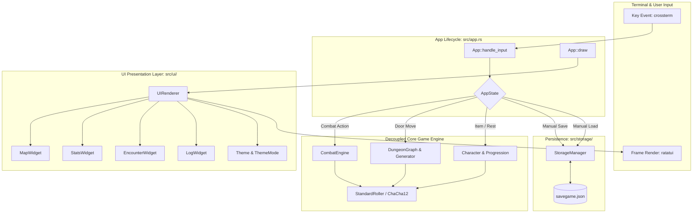

# Dark Fort (Rust) — Comprehensive Technical Architecture & Code Guide

> **Document Version**: 2.0 (Updated 2026)  
> **Status**: Living Reference  
> **Target Audience**: Core Developers & AI Coding Agents  

---

## 1. Executive Summary & Design Principles

**Dark Fort (Rust)** is a faithful, terminal-native roguelike adaptation of Pelle Nilsson's *Dark Fort* (the predecessor to *MÖRK BORG*). The player controls Kargunt, exploring a procedurally generated citadel of death, fighting monsters, collecting silver and scrolls, leveling up from 0 to 6, and attempting to survive all miseries.

### Architectural Core Principles
1. **Strict Core/UI Decoupling**: All gameplay mechanics, dungeon topologies, combat resolutions, and dice rolling reside in pure, UI-agnostic modules (`core/`, `dungeon/`, `simulation.rs`). No UI imports (`ratatui`, `crossterm`) penetrate the game engine.
2. **Explicit State Machine**: The entire game lifecycle is driven by a single top-level state enum (`AppState`). Sub-states and modal dialogs wrap the underlying gameplay state (e.g., `AppState::QuitConfirmation(Box<AppState>)`).
3. **Pluggable & Cryptographic Dice Generation**: Dice rolls are abstracted via the `DiceRoller` trait. Production uses ChaCha12 CSPRNG (`rand::thread_rng` / `StdRng`), while unit tests leverage deterministic `MockRoller`s without flaky or unpredictable test runs.
4. **Deterministic Simulation Capability**: The decoupled engine enables the `HeadlessSimulator`, which can run tens of thousands of automated games in seconds to calibrate balance, mortality curves, and loot probabilities.
5. **Manual, Intentional Persistence**: The game does not perform stealth auto-saves. Progress is saved only on explicit player request (`[S]` in the confirmation menu) and loaded via `[L]` with strict file-existence validation. Permadeath deletes saves on game over.

---

## 2. Directory & Module Topology

```
DarkFortRust/
├── Cargo.toml                  # Dependencies: crossterm, ratatui, rand, serde, thiserror
├── Makefile                    # Developer shortcuts (build, test, run, sim)
├── dark-fort-2018.pdf          # Original reference rulebook
├── savegame.json               # Active save slot (generated upon manual save)
├── data/                       # External data-driven definitions
│   ├── items/                  # JSON equipment registries (weapons, armours, potions, scrolls, gear)
│   ├── enemies/                # JSON monster registries (weak.json, tough.json)
│   └── shop.json               # Shop wares, hotkeys, and item price catalog
├── docs/                       # Technical and game design documentation
│   ├── rules_reference.md      # Game rules and tables
│   ├── game_design.md          # Gameplay mechanics spec
│   ├── architecture.md         # This technical reference
│   ├── osr_mechanics_comparison.md # Alternative OSR systems evaluation & comparative design
│   └── implementation_plan.md  # Roadmap history
├── src/
│   ├── lib.rs                  # Library entry re-exporting core, dungeon, storage, ui, app
│   ├── main.rs                 # CLI entry point, flag parsing, terminal setup/cleanup
│   ├── app.rs                  # App struct, AppState, event handling, draw dispatch
│   ├── simulation.rs           # Headless Monte-Carlo simulation runner & statistics
│   ├── core/                   # Pure game engine logic
│   │   ├── mod.rs
│   │   ├── dice.rs             # DiceFormula, DiceRoller trait, StandardRoller, MockRoller
│   │   ├── character.rs        # Character struct, HP, silver, inventory, perks
│   │   ├── equipment.rs        # Item, WeaponType, ArmorType, ScrollType
│   │   ├── registry.rs         # ItemRegistry, JSON loader, embedded fallbacks
│   │   ├── monsters.rs         # Monster stats, Weak & Tough monsters, special abilities
│   │   ├── combat.rs           # CombatEngine, attack resolution, damage calc, looting
│   │   └── progression.rs      # LevelUpReward, ProgressionManager, scoring
│   ├── dungeon/                # Dungeon generation & graph topology
│   │   ├── mod.rs
│   │   ├── room.rs             # RoomNode, RoomId, RoomShape, RoomContent, RoomStatus
│   │   ├── map.rs              # DungeonGraph, 2D coordinates, navigation, dead ends
│   │   └── generator.rs        # Procedural room generator with False Omen override
│   ├── storage/                # Persistence
│   │   ├── mod.rs
│   │   └── save_game.rs        # SaveData, StorageManager (save, load, delete)
│   └── ui/                     # Terminal rendering & TUI presentation
│       ├── mod.rs
│       ├── theme.rs            # ThemeMode, Theme struct (color palettes & styles)
│       ├── ascii_art.rs        # Raw ASCII art for encounters, death, and victory
│       ├── renderer.rs         # UIRenderer: 4-quadrant layout, modals, victory/death
│       └── widgets/            # Modular Ratatui widgets
│           ├── mod.rs
│           ├── map_widget.rs   # Dynamic ASCII dungeon map visualization
│           ├── stats_widget.rs # Character vitals, silver, equipped gear, inventory
│           ├── combat_widget.rs# Monster ASCII portrait, combat stats & abilities
│           └── log_widget.rs   # Chronicle log, action prompt, and hotkey guide
└── tests/
    ├── core_engine_tests.rs    # Pure combat, item, scroll, and progression unit tests
    ├── dungeon_tests.rs        # Procedural room generation, connectivity, dead-ends
    └── storage_and_simulation_tests.rs # Save/load round-trips & simulation smoke tests
```

---

## 3. High-Level Architecture & Data Flow



---

## 4. State Machine Architecture (`src/app.rs`)

The application state is strictly tracked by `AppState`:

```rust
#[derive(Debug, Clone, PartialEq, Eq)]
pub enum AppState {
    Exploring,                         // Navigating rooms; selecting door direction
    Combat(Monster),                   // Turn-based fight with active monster
    PitTrapPending,                    // Player must press Space to roll for Agility/Rope
    SoothsayerPrompt,                  // Riddle chamber; Space to roll d6 response
    PeddlerShop,                       // Trading post (buy Potions, Scrolls, Armor)
    LevelUpPending,                    // Space to roll destiny reward scratch-off
    QuitConfirmation(Box<AppState>),   // Modal confirmation overlay preserving previous state
    GameOver,                          // HP <= 0 or lethal hazard; R to restart, Q to exit
    Victory,                           // Kargunt achieved Level 6; R to delve anew, Q to exit
}
```

### State Transitions & Interactions
1. **Movement (`AppState::Exploring`)**:
   - `W/A/S/D` or arrows: calls `app.try_move(dir)`.
   - Result:
     - `NavigationEvent::EnteredNewRoom(id)` $\to$ `enter_current_room()` triggers encounter, trap, shop, or empty chamber.
     - `NavigationEvent::BacktrackedToRoom(id)` $\to$ returns safely to existing room (`Exploring`).
     - `NavigationEvent::WanderingMonsterAmbush(m)` $\to$ interrupts directly into `AppState::Combat(m)`.
     - `NavigationEvent::DeadEndNoDoorsLeft` $\to$ `AppState::GameOver`.
2. **Combat (`AppState::Combat`)**:
   - `[A]` Attack: `CombatEngine::resolve_attack_round` calculates player roll + modifiers vs monster defense, then monster counter-attack.
   - `[S]` Spell: Casts *Palms Open the Southern Gate* if scroll available.
   - `[P]` Potion: Consumes healing potion from inventory.
   - `[C]` Cloak: Consumes charge of *Cloak of Invisibility* to slip away.
   - `[F]` Flee: Suffers flee penalty roll, marks room as `RoomStatus::FledFrom`, transitions to `Exploring`.
   - Victory awards silver, loot, and progression points. If points reach threshold $\to$ `LevelUpPending`.
3. **Modal Overlay (`QuitConfirmation(Box<AppState>)`)**:
   - Triggered by `[Q]` or `[Esc]` from any active delve state.
   - Preserves previous state in heap box.
   - Handled keys:
     - `[Y]`: Sets `should_quit = true` immediately **without saving**.
     - `[S]`: Calls `save_game_to(DEFAULT_SAVE_PATH)` $\to$ restores `*prev_state` with success message.
     - `[L]`: Checks if save file exists $\to$ loads via `load_game_from(DEFAULT_SAVE_PATH)` $\to$ resumes.
     - `[N]` or `[Esc]`: Restores `*prev_state` without changes.

---

## 5. Core Engine Deep Dive (`src/core/`)

### 5.1 Dice Rolling Subsystem (`core/dice.rs`)
- **Trait Definition**:
  ```rust
  pub trait DiceRoller {
      fn roll_d4(&mut self) -> i32;
      fn roll_d6(&mut self) -> i32;
      fn roll_formula(&mut self, formula: DiceFormula) -> i32;
      fn check_x_in_6(&mut self, target_x: i32) -> bool;
  }
  ```
- **Implementations**:
  - `StandardRoller<R: Rng>`: Backed by `rand` 0.8 using ChaCha12. Uses rejection sampling `gen_range(1..=6)` to eliminate modulo bias.
  - `MockRoller`: Seeded with explicit `Vec<i32>` sequences for deterministic unit tests.

### 5.2 Character Model (`core/character.rs`)
Tracks Kargunt's condition and perks:
- `hp` & `max_hp`: Starts at 15 (max 20).
- `silver`: Currency (starts at $15 + 1d6$).
- `weapon` & `armor`: Currently equipped combat gear.
- `inventory`: `Vec<Item>`.
- `attack_modifier`: Stat boost (+1 attack bonus).
- `defense_modifier`: Stat boost (damage reduction).
- `halved_weak_monster` / `halved_tough_monster`: Level perks halving damage taken from a specific monster type.
- Active scroll counters: `active_daemon_fights_left`, `active_aegis_uses_left`.

### 5.3 Equipment & Registry System (`core/equipment.rs`, `core/registry.rs`)
The equipment system is entirely data-driven, loaded on launch from external JSON files in `data/items/` with compile-time embedded fallbacks (`include_str!`) to guarantee standalone zero-panic execution:
- **`data/items/weapons.json`**: Weapon catalog with IDs, names, dice formulas (`1d4`, `1d6`, `1d6+1`, `1d6+2`), attack bonuses, and shop prices.
- **`data/items/armours.json`**: Armor definitions with absorption formulas (`1d4`, `1d6`, etc.) and costs.
- **`data/items/potions.json`**: Healing draughts with recovery formulas (`1d6`, `2d6`, etc.).
- **`data/items/scrolls.json`**: Esoteric scrolls (`SummonWeakDaemon`, `PalmsOpenSouthernGate`, `AegisOfSorrow`, `FalseOmen`) with charge formulas.
- **`data/items/gear.json`**: Utility equipment (`Rope`, `CloakOfInvisibility`).

#### Adding New Items Without Code Changes
Players or modders can add new items directly to the JSON files in `data/items/`. The engine dynamically parses them into `WeaponType::Custom` or `Item::Custom*` variants, making them immediately available in starting rolls, room item drops, peddler shops, and combat calculations without recompilation.

- **Standard Weapons**:
  - `Warhammer` (1d6 damage, 9s)
  - `Dagger` (1d4 damage, +1 attack bonus, 6s)
  - `Sword` (1d6 damage, +1 attack bonus, 12s)
  - `Flail` (1d6+1 damage, 15s)
  - `Mighty Zweihänder` (1d6+2 damage, 25s)
  - `Unarmed` (1d4-1 damage, min 0, 0s)
  - `Custom`: Any weapon added to `weapons.json` with user-defined damage formula, attack bonus, and price.
- **Armor**:
  - `Leather Armor` (1d4 absorption, 10s) or custom armors from `armours.json`.
- **Scrolls**:
  - `SummonWeakDaemon`: Daemon fights alongside player for 1d4 fights, contributing +1d4 damage.
  - `PalmsOpenSouthernGate`: 1d4 uses, deals 1d6+1 direct unblockable spell damage.
  - `AegisOfSorrow`: 1d4 uses, absorbs 1d4 damage per monster strike.
  - `FalseOmen`: 1 use; forces favorable dungeon exploration outcome or reroll.
- **Gear**:
  - `Rope` (+1 on pit trap agility checks, 5s)
  - `Cloak of Invisibility` (bypasses 1d4 combat encounters, 15s)

### 5.4 Data-Driven Monster Hierarchy & Shop Economy (`core/monsters.rs`, `core/registry.rs`)
Like equipment, monsters and shop wares are completely data-driven and loaded on startup from external JSON files with embedded fallbacks:
- **`data/enemies/weak.json`**: Weak monster catalog (Blood-drenched Skeleton, Catacomb Cultist, Goblin, Undead Hound).
- **`data/enemies/tough.json`**: Tough monster catalog (Necro-Sorcerer, Small Stone Troll, Medusa, Ruin Basilisk).
- **`data/shop.json`**: Shop inventory wares, hotkeys, buy prices, and general sell price valuations.

#### Custom Enemies & Modding
New monsters can be defined in `weak.json` or `tough.json` with customizable:
- `points_to_hit` & `points_awarded`
- `hp` and `damage_formula` (`1d4`, `1d6`, `1d6+1`, etc.)
- `loot` (`None`, `DaggerChance`, `ScrollChance`, `RopeChance`, `NecroSilver`, `MedusaSilver`)
- `post_hazard` (`None`, `MaggotTransformation`, `Petrification`, `ImmediateLevelUp`)

#### Dynamic Shop Config
The peddler shop dynamically reads `ShopConfig` from `data/shop.json`, allowing operators to add new wares, change potion/scroll/armor costs, or offer weapons and gear without recompilation.

- **Combat Formula**:
  $$\text{Player Roll} = 1d6 + \text{Weapon Mod} + \text{Character Attack Bonus}$$
  $$\text{Hit Condition}: \text{Player Roll} \ge \text{Monster Defense}$$
  $$\text{Counterattack}: \text{Monster Damage} - \text{Armor Absorb} - \text{Aegis Absorb}$$

---

## 6. Dungeon Graph & Generation (`src/dungeon/`)

### 6.1 Coordinate Grid & Topology
The dungeon is an undirected planar graph stored in `DungeonGraph`:
- Each `RoomNode` has a discrete grid coordinate `(x, y)`:
  - North: $(x, y - 1)$
  - South: $(x, y + 1)$
  - East: $(x + 1, y)$
  - West: $(x - 1, y)$
- Rooms contain 1 to 4 doors oriented by `Direction`.
- Doors transition between `Unchecked`, `Open(target_id)`, and `Wall`.

### 6.2 Generation & Ambush Algorithm
When traversing an unexplored door:
1. `DungeonGraph::traverse_door` computes target coordinate.
2. Checks for coordinate collision. If coordinate is occupied, door links back to existing room or converts to a wall.
3. Generates room shape (`RoomShape`) and contents (`RoomContent`) via weighted d6 rolls:
   - 1-2: Weak Monster
   - 3: Tough Monster
   - 4: Trap or Special (Pit Trap, Soothsayer, Peddler)
   - 5: Item / Mystic Scroll Stash
   - 6: Empty Chamber
4. **Dead-End Detection**: If a room generates with all doors blocked by existing rooms or walls, dead-end detection triggers. Backtracking through cleared rooms incurs a 2-in-6 chance of a Wandering Monster ambush.

---

## 7. User Interface & Theming Subsystem (`src/ui/`)

### 7.1 Quad-Quadrant Composition
`UIRenderer::render_game` splits the terminal into an adaptive layout:
```
┌────────────────────────────────────────────────────────────────────────┐
│  DARK FORT  |  Room #1: Rectangular Chamber  |  'Dried blood...'      │ <-- Header (3 lines)
├───────────────────────────────────┬────────────────────────────────────┤
│                                   │                                    │
│          DUNGEON MAP              │          CHARACTER STATS           │
│         (`MapWidget`)             │          (`StatsWidget`)           │
│                                   │                                    │
├───────────────────────────────────┼────────────────────────────────────┤
│                                   │                                    │
│        ENCOUNTER & ART            │        CHRONICLE & ACTIONS         │
│       (`EncounterWidget`)         │           (`LogWidget`)            │
│                                   │                                    │
└───────────────────────────────────┴────────────────────────────────────┘
```

### 7.2 Theme Engine (`ui/theme.rs`)
Colors are dynamically controlled through `ThemeMode`:
- **`ClassicWhite`**: Monochrome white on black dungeon aesthetic.
- **`AmberCrt`**: Vintage warm phosphor terminal palette (`Color::Rgb(255, 176, 0)`).
- **`GreenCrt`**: Classic green phosphor hacker console palette (`Color::Rgb(51, 255, 51)`).
- **`MorkBorg`**: High-contrast doom art palette (Doom Yellow `#FFEB3B`, Blood Red `#FF1744`, Toxic Green `#00E676`).

### 7.3 Modal Dialog Rendering Rule
- Modal dialogs (such as `render_quit_dialog`) use `ratatui::widgets::Clear` across their target `Rect` to prevent background character bleed-through.
- Quit dialog colors are theme-aware:
  - In `ClassicWhite`, dialog border and text render in **Amber** (`Color::Rgb(255, 176, 0)`) for high-contrast pop.
  - In other themes (`AmberCrt`, `GreenCrt`, `MorkBorg`), dialog renders in **White** (`Color::White`).
- Dialog height is dynamically responsive, ensuring all 4 options (`[Y]`, `[S]`, `[L]`, `[N]`) remain fully visible on compact displays.

---

## 8. Persistence Architecture (`src/storage/`)

### 8.1 Schema (`SaveData`)
```rust
#[derive(Debug, Clone, Serialize, Deserialize)]
pub struct SaveData {
    pub character: Character,
    pub dungeon: DungeonGraph,
    pub progression: ProgressionManager,
    pub theme_mode: ThemeMode,
}
```
All persistent game objects implement Serde `Serialize` and `Deserialize`.

### 8.2 Save / Load Lifecycle Rules
- **No Background Autosaves**: Entering rooms or finishing battles does not write to disk.
- **Manual Save**: Initiated by `Q/Esc` $\to$ `[S]`. Serializes pretty-printed JSON atomically to `savegame.json`.
- **Manual Load**: Initiated by `Q/Esc` $\to$ `[L]`. Checks `StorageManager::exists(path)`. If present, deserializes and restores game state. If absent, logs an error without modifying state.
- **Permadeath**: When `player_hp <= 0` or a fatal curse triggers, `StorageManager::delete(DEFAULT_SAVE_PATH)` cleans the disk to enforce true roguelike stakes.

---

## 9. Simulation & Testing Strategy

### 9.1 Headless Monte-Carlo Simulator (`src/simulation.rs`)
Accessible via `cargo run --release -- --headless-sim 1000`:
- Bypasses all terminal UI and event loops.
- Runs hundreds or thousands of complete playthroughs using deterministic `StdRng` seeds.
- Outputs comprehensive telemetry: win rates, death rates, average rooms explored, and death cause breakdowns (e.g., Goblin vs. Basilisk vs. Pit Trap).

### 9.2 Automated Unit & Integration Tests
- **`tests/core_engine_tests.rs`**: Verifies combat math, armor absorption, scroll triggers, level up scratch-offs, and weapon damage.
- **`tests/dungeon_tests.rs`**: Verifies procedural generation, False Omen scroll overrides, dead-end detection, and backtracking mechanics.
- **`tests/storage_and_simulation_tests.rs`**: Tests save/load roundtrips using isolated target JSON paths to guarantee parallel thread safety.

---

## 10. Developer Guide: How to Make Common Changes

### Adding a New Item
1. Add the variant to `Item` in [`src/core/equipment.rs`](../src/core/equipment.rs).
2. Implement its name, price, and dice effects in `equipment.rs`.
3. Add handler in `App::use_item` or `PeddlerShop` in [`src/app.rs`](../src/app.rs).
4. Update `StatsWidget` in [`src/ui/widgets/stats_widget.rs`](../src/ui/widgets/stats_widget.rs) if it has specialized rendering.

### Adding a New Monster
1. Add the variant to `WeakMonsterType` or `ToughMonsterType` in [`src/core/monsters.rs`](../src/core/monsters.rs).
2. Configure its HP, Defense, Damage dice formula, and Loot table in `Monster::new_weak` / `Monster::new_tough`.
3. Add ASCII portrait to [`src/ui/ascii_art.rs`](../src/ui/ascii_art.rs) and hook it in `EncounterWidget`.
4. If it has special attack triggers (like Medusa or Necro-Sorcerer), add handling inside `CombatEngine::resolve_attack_round` in [`src/core/combat.rs`](../src/core/combat.rs).

### Modifying Keybindings
1. Update `App::handle_input` in [`src/app.rs`](../src/app.rs) under the relevant `AppState`.
2. Update the corresponding hotkey tuple in `App::draw` (`hotkeys` slice) so the chronicle prompt bar matches keyboard bindings.
3. If modal dialogs are involved, adjust `render_quit_dialog` or the relevant widget in [`src/ui/renderer.rs`](../src/ui/renderer.rs).
