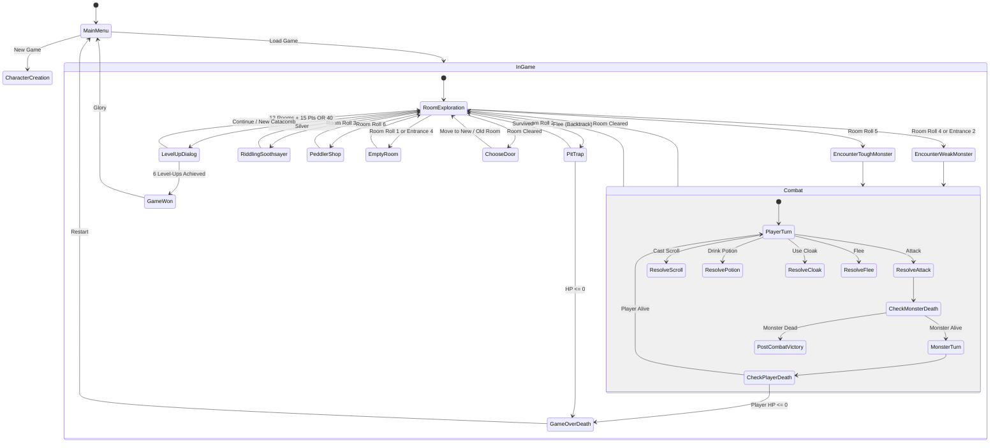

# Dark Fort — Terminal ASCII Game Design Document

## 1. Vision & Tone

**Dark Fort** in the terminal is designed as an atmospheric, gritty, turn-based ASCII dungeon crawler faithful to the 2018 Pelle Nilsson / Stockholm Kartell micro-game that birthed *MÖRK BORG*.

### Aesthetic Pillars
- **Old-school ASCII Art**: Crisp terminal characters (`#`, `.`, `@`, `+`, `~`, `\`, `/`) for map layout and ASCII art portraits for monsters, items, and encounters.
- **MÖRK BORG Color Palette**: High-contrast, gritty styling using 16-color or 256-color ANSI / truecolor terminal support:
  - Deep Black background (`#0c0c0c`)
  - Doom Yellow (`#ffeb3b` / `#fee12b`)
  - Blood Red (`#d32f2f` / `#ff1744`)
  - Necrotic Bone White (`#e0e0e0`)
  - Eerie Violet / Maggot Green accents
- **Classic CRT / Amber / Monochrome Mode**: Optional switchable visual themes (e.g., Pure Amber, Retro Green, Classic Monochrome) for authentic 1980s mainframe roguelike nostalgia.
- **Keyboard-Driven Fluidity**: Zero mouse required. Supports both Vim keys (`h/j/k/l`) and Arrow keys, plus single-key action commands (`[A]ttack`, `[F]lee`, `[P]otion`, `[S]croll`, `[C]loak`, `[B]uy`, etc.).

---

## 2. Terminal UI Layout (Ratatui)

The game runs in standard 80x24 or larger terminals (recommended: 100x30 or auto-scaling) split into four core panels:

```
+----------------------------------------------------------------------------------------------------+
| DARK FORT [v0.1.0]           Room 07/12 (Square)                 "The catacombs stink of sulphur" |
+--------------------------------------------------+-------------------------------------------------+
|                                                  | KARGUNT (The Catacomb Rogue)                    |
|                DUNGEON MAP                       | ----------------------------------------------- |
|                                                  | HP:     [██████████░░░░░] 10/15                 |
|                   [E]                            | Silver: 24s           Points: 8/15              |
|                    |                             | Level:  0             Rooms Explored: 7         |
|              [#02]-[#03]                         | ----------------------------------------------- |
|                     |                            | WEAPON: Sword (1d6, +1 att)                     |
|                    [#04]--[#05]                  | ARMOR:  Leather (-1d4 dmg)                      |
|                            |                     | ----------------------------------------------- |
|                           [#06]--[@07]           | INVENTORY:                                      |
|                                   :?             |  [1] Potion (1d6 hp) [x2]                       |
|                                                  |  [2] Rope (+1 trap)                             |
|                                                  |  [3] Scroll: Palms Open Southern Gate (2 uses)  |
|                                                  |  [4] Cloak of Invisibility (2 uses)             |
+--------------------------------------------------+-------------------------------------------------+
| ENCOUNTER / COMBAT DISPLAY                       | EVENT LOG & PROMPT                              |
|                                                  |                                                 |
|          _.-'''''-._                             | > You open the splintered iron door.            |
|        .'  _     _  '.                           | > A Blood-drenched Skeleton rattles toward you! |
|       /   (o)   (o)   \                          | > Skeleton HP: 6/6 | Points: 3                  |
|      |        ^        |   BLOOD-DRENCHED        | > Kargunt rolled [ ⚄ 5 ] + 1 = 6 (Hit!)        |
|      |      \___/      |   SKELETON              | > Sword deals 4 damage! Skeleton has 2 HP left. |
|       \               /    Points: 3 | HP: 2/6   | > Skeleton misses Kargunt!                      |
|        '._         _.'     Damage: 1d4           |                                                 |
|           '-------'                              | What do you do?                                 |
|                                                  | [A]ttack  [S]croll  [P]otion  [C]loak  [F]lee   |
+--------------------------------------------------+-------------------------------------------------+
```

---

## 3. Screen Components

### 1. Header Bar
- Game title & status
- Current room index & shape name
- Ambient flavor text quote (gloomy, cynical dark-fantasy tone)

### 2. Dungeon Map Panel
- **Node-and-Room ASCII Graph**: Displays the connected dungeon layout.
- Symbols:
  - `[E]`: Entrance room
  - `[@]`: Current player location
  - `[##]`: Explored room (visited, cleared)
  - `[?]` / `[:?]`: Unexplored adjacent door
  - `---` / `|`: Corridors and door links
- **Room Detail View toggle (`[Tab]`)**: Switches the map into an architectural ASCII floor plan of the current room shape (Square, Skull, Irregular Cave, etc.) with walls, doors, and features.

### 3. Kargunt Status Panel
- Dynamic HP bar with visual color degradation (Green -> Yellow -> Blinking Red).
- Current silver and accumulated points.
- Equipped weapon and armor status.
- Expandable inventory list with remaining consumable uses.
- Active buffs (e.g., *Summoned Daemon active: 3 fights left*).

### 4. Encounter & ASCII Art Panel
- High-fidelity ASCII art portraits for:
  - All 4 Weak Monsters (Skeleton, Cultist, Goblin, Hound)
  - All 4 Tough Monsters (Necro-Sorcerer, Stone Troll, Medusa, Basilisk)
  - Peddler from beyond the void
  - Riddling Soothsayer
  - Pit Trap / Treasure Chest
  - Victory & Death screens
- Monster status bar (HP, points value, special notes).

### 5. Event Log & Interaction Prompt
- Scrolling colored event history.
- Dice roll visualizers (e.g. `[ ⚂ 3 ] + 1 = 4 vs 3 -> SUCCESS`).
- Context-sensitive hotkey bar at the bottom.

---

## 4. Visualizing Room Shapes in ASCII

When entering or inspecting a room, the game presents its authentic 2d6 shape:

| 2d6 Roll | Shape | ASCII Representation Sample |
|---|---|---|
| **2** | Irregular Cave | `  /~~~\_   `<br>` /       \  `<br>`(_   @    ) `<br>`  \___/~~   ` |
| **3** | Oval | ` .--------. `<br>`/    @     \`<br>`\          /`<br>` '--------' ` |
| **4** | Cross-shaped | `   |  |   `<br>`---+  +---`<br>`|    @    |`<br>`---+  +---`<br>`   |  |   ` |
| **5** | Corridor | `+----------------+`<br>`|       @        |`<br>`+----------------+` |
| **6–8** | Square | `+----------+`<br>`|          |`<br>`|    @     |`<br>`|          |`<br>`+----------+` |
| **9** | Round | `   .----.   `<br>`  /   @  \  `<br>` |        | `<br>`  \      /  `<br>`   '----'   ` |
| **10** | Rectangular | `+--------------------+`<br>`|                    |`<br>`|         @          |`<br>`+--------------------+` |
| **11** | Triangular | `     /\     `<br>`    /  \    `<br>`   / @  \   `<br>`  /______\  ` |
| **12** | Skull-shaped | `  .-""""-.  `<br>` /  o  o  \ `<br>`|    /\    |`<br>` \  ====  / `<br>`  '-....-'  ` |

---

## 5. Game Flow & State Machine



---

## 6. Audio & Feedback (Terminal Bells & Animations)

- **Text Roll Animations**: Fast frame-by-frame dice tumbling animation (`[ - ] -> [ \ ] -> [ | ] -> [ ⚄ 5 ]`) for suspenseful combat and trap rolls.
- **Screen Shake Effect**: Inverted colors / quick red flash when player suffers critical damage or death-ray.
- **ASCII Particle Splatters**: Skeletal bones or blood glyphs (`*`, `%`, `@`) exploding when a foe is slain.
- **Sound**: Terminal bell (`\a`) triggers for critical hits or fatal warnings (toggleable in settings).
