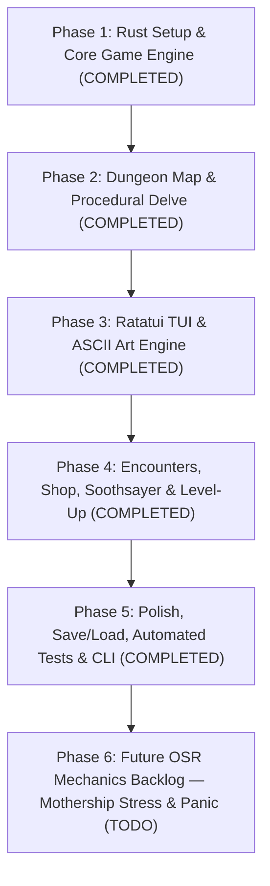

# Dark Fort — Terminal ASCII Roguelike Implementation Plan

This plan outlines the staged development of the **Dark Fort** terminal ASCII roguelike in Rust.

---

## Roadmap Overview

---

## Phase 1: Rust Setup & Core Game Engine

**Goal**: Establish the pure game logic in Rust with 100% rule fidelity to `dark-fort-2018.pdf`. Fully covered by unit tests without any UI dependency.

### Deliverables:
1. **Cargo Configuration**:
   - Initialize Rust project with `ratatui`, `crossterm`, `rand`, `serde`, `serde_json`, `thiserror`.
2. **Dice Module (`src/core/dice.rs`)**:
   - `DiceRoll` enum & roller for `d4`, `d6`, `2d6`, `d4-1`, `d6+1`, `d6+2`, `3d6`, `d4*d6`.
   - Seedable RNG support for reproducible runs.
3. **Character & Equipment (`src/core/character.rs`, `src/core/equipment.rs`)**:
   - Starting character generation: Kargunt with 15 HP, 15+d6 silver, starting weapon (d4), starting item/relic (d4).
   - Weapons: Warhammer, Dagger (+1 att), Sword (+1 att), Flail, Mighty Zweihänder, Unarmed.
   - Items & Consumables: Potion (heal d6), Rope (+1 trap), Armor (-d4), Cloak of Invisibility (d4 uses).
   - Scrolls: Summon Weak Daemon (d4 fights), Palms Open the Southern Gate (d6+1 dmg, d4 uses), Aegis of Sorrow (-d4 dmg, d4 uses), False Omen (pick room / reroll).
4. **Monsters & Combat Engine (`src/core/monsters.rs`, `src/core/combat.rs`)**:
   - All 4 Weak Monsters (Skeleton, Cultist, Goblin, Hound) with loot drops.
   - All 4 Tough Monsters (Necro-Sorcerer with death-ray & maggot hazard, Stone Troll, Medusa with petrify hazard, Basilisk with level-up boon).
   - Full attack roll resolution (d6 + bonuses vs monster points), damage calculations, armor mitigation, fleeing mechanics (take d4 dmg).
5. **Level-Up System (`src/core/progression.rs`)**:
   - Level-up triggers: 12 rooms + 15 points, OR 40 silver.
   - Scratch-off d6 table with rerolls for repeats.
   - 6th level retirement / 7th Misery victory condition.

**Verification**: Comprehensive headless test suite verifying combat probabilities, item usages, and level-up milestones.

---

## Phase 2: Dungeon Map & Procedural Delve

**Goal**: Model the catacomb graph, room shapes, door connections, and dungeon traversal.

### Deliverables:
1. **Room & Geometry Models (`src/dungeon/room.rs`)**:
   - All 10 room shapes from the 2d6 table: Cave, Oval, Cross, Corridor, Square, Round, Rectangular, Triangular, Skull.
   - Door counts from d4 table (No door / 1 door / 2 doors).
   - Room states: Unexplored, Explored, FledFrom.
2. **Dungeon Graph (`src/dungeon/map.rs`)**:
   - 2D grid positioning for connected rooms so rooms do not overlap.
   - Backtracking navigation: moving between connected explored rooms.
   - 1-in-4 wandering weak monster check when re-entering explored or fled rooms.
   - Dead-end detection (adventure over if all doors are dead ends).
3. **Procedural Generator (`src/dungeon/generator.rs`)**:
   - Entrance room generator (d4 doors + entrance encounter).
   - Room content roller (Nothing, Pit Trap, Soothsayer, Weak Monster, Tough Monster, Peddler).

**Verification**: Unit tests simulating map expansion, path finding, door consistency, and dead-end validation.

---

## Phase 3: Ratatui TUI & ASCII Art Engine

**Goal**: Build the vintage terminal interface with rich ASCII graphics.

### Deliverables:
1. **Terminal Setup & Event Loop (`src/main.rs`, `src/app.rs`)**:
   - Raw mode, alternate screen, mouse capture disabled, panic cleanup hook.
   - Non-blocking tick event loop handling keyboard events (`crossterm`).
2. **ASCII Art Assets (`src/ui/ascii_art.rs`)**:
   - Dark Fort gothic title banner.
   - ASCII portraits for all 8 monsters:
     - 💀 Blood-drenched Skeleton
     - 🧙‍♂️ Catacomb Cultist
     - 👺 Goblin
     - 🐕 Undead Hound
     - 👁️ Necro-Sorcerer
     - 🗿 Small Stone Troll
     - 🐍 Medusa
     - 🦎 Ruin Basilisk
   - ASCII portraits for Peddler, Soothsayer, Pit Trap, Chest, Death & Victory.
3. **UI Layout Compositor (`src/ui/renderer.rs`)**:
   - Header with room shape & ambient dark fantasy flavor lines.
   - Dynamic Dungeon Map Widget (`src/ui/widgets/map_widget.rs`): ASCII nodes and corridors.
   - Status & Inventory Widget (`src/ui/widgets/stats_widget.rs`): Visual HP bar, stats, equipment, scrolls.
   - Combat & Encounter Widget (`src/ui/widgets/combat_widget.rs`): Monster art + stats.
   - Event Log Widget (`src/ui/widgets/log_widget.rs`): Scrolling colored action narrative.
4. **Themes (`src/ui/theme.rs`)**:
   - MÖRK BORG palette: Black, Doom Yellow, Blood Red, Bone White.
   - Amber CRT mode: Retro amber monochrome on black.
   - Green CRT mode: Classic phosphorus green terminal.

**Verification**: Visual inspection in terminal, verifying layout responsiveness across different terminal dimensions (min 80x24).

---

## Phase 4: Encounters, Shop, Soothsayer & Level-Up

**Goal**: Implement interactive sub-screens for all specific game encounters.

### Deliverables:
1. **Interactive Combat View**:
   - Hotkeys: `[A]ttack`, `[S]croll`, `[P]otion`, `[C]loak`, `[F]lee`.
   - Dice roll tumble animation in the log.
   - Visual screen flash / inverted highlight on critical hits.
2. **Peddler Shop View (`src/ui/widgets/shop_widget.rs`)**:
   - Buy and sell item menu with prices.
   - Real-time silver tracking.
3. **Riddling Soothsayer Dialog (`src/ui/widgets/dialog_widget.rs`)**:
   - Interactive prompt: choice between +10 silver or +3 points on odd roll, shockwave resolution on even roll.
4. **Pit Trap Resolver**:
   - Auto-checks for rope bonus (+1 roll), displays dice roll and HP damage.
5. **Level-Up Screen**:
   - Displays scratched-off rewards.
   - Selection prompt: Start a new catacomb OR keep exploring the current one.
   - Choice for reward #6: Select 1 Weak and 1 Tough monster for permanent damage halving.

**Verification**: Interactive testing of every encounter type, shop transactions, and level-up progressions.

---

## Phase 5: Persistence, Playtesting & CLI Polish

**Goal**: Final production polish, save/load capability, and automated regression suite.

### Deliverables:
1. **Save & Resume (`src/storage/save_game.rs`)**:
   - Auto-save on each room entered / exited (`savegame.json`).
   - "Continue Delve" from Main Menu.
   - Permadeath cleanup on player death.
2. **CLI Options**:
   - `--seed <NUMBER>`: Play a specific dungeon seed.
   - `--theme <mork-borg|amber|green>`: Set default visual palette.
   - `--headless-sim <ROUNDS>`: Run automated simulation benchmarks.
3. **Automated End-to-End Simulation**:
   - Monte-Carlo play simulation to test win rates and ensure no game-breaking deadlocks.
4. **Documentation & User Guide**:
   - `README.md` with build instructions (`cargo run --release`), key bindings, and game rules.

---

## Phase 6: Future OSR Mechanics Backlog — Mothership Stress & Panic (TODO)

**Goal**: Implement psychological survival horror mechanics derived from *Mothership*, adapted for *Dark Fort*'s terminal roguelike engine.

### Deliverables:
1. **Character Stress Tracking (`src/core/character.rs`)**:
   - Add `pub stress: u8` and `pub min_stress: u8` (default starting stress: 2).
   - Stress Accumulation Triggers:
     - Taking a critical hit or damage $\ge 4$ in a single blow ($+1$ Stress).
     - Missing 2 consecutive attacks in combat ($+1$ Stress).
     - Entering a dark dead-end room or triggering a pit trap ($+1$ Stress).
     - Witnessing horrific monsters (Medusa, Necro-Sorcerer) upon chamber entry ($+1$ Stress).
   - Stress Relief:
     - Quaffing wine / resting at Peddler shop ($-2$ Stress).
     - Gaining a level-up milestone (resets Stress to `min_stress`).
2. **Panic Check Engine (`src/core/combat.rs`, `src/core/character.rs`)**:
   - Trigger: Failing a hazard roll, falling to $\le 3$ HP, or experiencing an ambush.
   - Panic Roll: Roll $1d20$ vs `current_stress`:
     - If $\text{Roll} > \text{Stress}$: Kept composure (no effect).
     - If $\text{Roll} \le \text{Stress}$: **PANIC TRIGGERED!**
3. **Panic Effect Table**:
   - Roll on Panic Table:
     - **Tremors**: $-1$ to attack rolls for the next 3 turns.
     - **Frenzied Scramble**: Automatically drops 1 equipped item in terror.
     - **Scream of Terror**: Instantly summons a wandering weak monster to the adjacent room.
     - **Catatonic Paralysis**: Loses the next combat turn entirely.
     - **Psychotic Rage**: Deals $+2$ damage on next hit, but takes $+2$ counter-attack damage.
     - **Terminal Heart Failure**: If Stress $\ge 15$ and roll is 1: Instant collapse/death.
4. **TUI Visualization & Chronicle Log (`src/ui/widgets/stats_widget.rs`, `src/ui/widgets/log_widget.rs`)**:
   - Render a dedicated **STRESS** bar in the stats widget: `STRESS: [■■■■······] 4/20`.
   - Dynamic terminal theme pulse / screen color inversion when Panic triggers.
   - Distinctive chronicle log notifications with Gothic dread flavor text.

---

## Status & Evolution
All Phases 1 through 5 are fully implemented, verified with 38 unit/integration tests and headless Monte-Carlo simulation. Phase 6 is prioritized in the design backlog for future execution.

